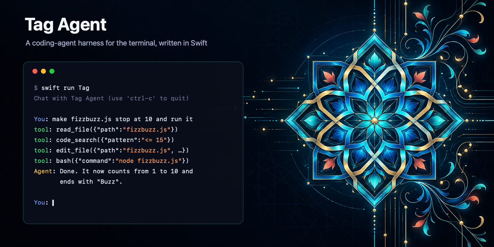

<p align="center">
  
</p>

# Tag Agent

[](https://github.com/telip007/tag-agent/actions/workflows/ci.yml)


[](LICENSE)

A coding-agent harness for the terminal, written in Swift, to learn how coding
agents actually work: the loop, tools, context and streaming.

It started as a Swift port of Thorsten Ball's
[How to build an agent](https://ampcode.com/notes/how-to-build-an-agent):
the first chat loop was written by hand, everything since by coding agents
under strict automated checks (see [the decisions](wiki/index.md#decisions)).

You pick the model. Tag talks to your **ChatGPT plan** (Codex models, through
OpenAI's Sign in with ChatGPT), an **OpenCode Go** subscription, or
**OpenRouter** (through
[swift-openrouter](https://github.com/telip007/swift-openrouter), a git
submodule in `Packages/OpenRouter`). The first start walks you through
connecting a provider and choosing a model. After that Tag starts with the
model and reasoning effort you used last. `/model` opens a searchable picker,
and `/model <provider>/<model>` (for example `/model go/kimi-k3`) switches
straight away while keeping the conversation. The system prompt gives the
model the tools, the working directory and the project's `AGENTS.md` if
there is one.

> Status: early. The harness is being built step by step.


The mascot is a tabby street cat in a fez, drawn as pixel art. It greets you
in an empty conversation, and the same sprite draws the logo and the banner
(`swift .github/assets/render-assets.swift`).

## Tools

| Tool | What it does |
| --- | --- |
| `read_file` | read a text file |
| `list_files` | list a directory recursively (hidden entries skipped) |
| `edit_file` | replace one exact match in a file, or create a file |
| `bash` | run a shell command in the working directory |
| `code_search` | search with [ripgrep](https://github.com/BurntSushi/ripgrep) |

> [!WARNING]
> The agent edits files and runs shell commands in the directory you start it
> in, without asking first. Use it in a directory under version control.

## The terminal UI

Tag runs full screen, with [Stipple](https://github.com/telip007/stipple). The
conversation fills the left pane: your messages, replies, tool calls grouped
into trays you can expand, and every file edit as a small diff. The panel on
the right shows the model, how full its context window is, cache reads and
writes reported for the latest completed reply, what the session has cost, how long
it has run, and which files changed. Missing cache metrics are omitted;
reported zeros are shown. See [prompt caching](wiki/concepts/prompt-caching.md)
for the provider policies and limits.

| Key | What |
| --- | --- |
| Enter | send; while the agent works, queue the message (type-ahead) |
| `/clear` | start the conversation over (keeps the system prompt) |
| ↑ / ↓ | recall sent messages; ↓ past the newest restores your draft |
| Esc | browse the conversation: ↑↓ to move, Enter to expand, c to copy |
| Page Up / Down | scroll the conversation |
| Ctrl-P | command palette: panel, copy the last reply, browse, quit |
| Tab | show or hide the session panel |
| Ctrl-C | clear the line; on an empty line, press twice to quit |
| Ctrl-D | quit, on an empty line |

The mouse works too: the wheel scrolls, a click expands a tool tray or a diff,
and the hints in the footer are buttons. To select text with the mouse, hold
Shift (Option in some macOS terminals).

Input needs an interactive terminal; piping messages on stdin is not
supported.

## Setup

```sh
git clone --recurse-submodules https://github.com/telip007/tag-agent.git
cd tag-agent
make bootstrap   # SwiftLint, ripgrep, git hooks, submodule
make run         # swift run -c release Tag
```

The first start asks you to connect a provider: sign in with ChatGPT in the
browser, or paste an OpenCode Go or OpenRouter API key. Keys can also come
from `OPENCODE_API_KEY` and `OPENROUTER_API_KEY`. Credentials and settings
are kept in `~/.config/tag/` (`$XDG_CONFIG_HOME/tag` or `$TAG_CONFIG_DIR`
when set), readable only by you.

Run the optimised build: a debug build (`swift run Tag`) draws several
times slower, which shows when resizing a long session.

Requires Swift 6.2+ (Xcode 26) and macOS 15+.

## Development

`make check` runs everything CI runs: wiki lint, swift-format, SwiftLint, a
build with all warnings as errors, and tests with a coverage gate. The
reasoning behind this setup and every decision so far lives in the project
wiki: start at [wiki/index.md](wiki/index.md).

Working with a coding agent? See [AGENTS.md](AGENTS.md). Contributing? See
[CONTRIBUTING.md](CONTRIBUTING.md).

## License

[Apache 2.0](LICENSE).
