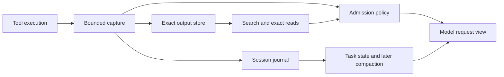

# Native context management research

Status: **historical research baseline**, followed by the authorized
[native implementation](../concepts/native-context.md) and
[decision 0016](../decisions/0016-native-context.md).
Baseline: Tag `5268e132fa4380b16d7dfa567a21c82cdc7d5778`.
The observations below describe that baseline, before persistent sessions and
native context tools. Implementation and verification status live in the
[execution plan](native-context-plan.md), not in this historical assessment.
Scope: concepts from [Context Mode](../sources/context-mode.md) and
[eight primary papers](../sources/agent-context-research.md).

## Conclusion

**Yes: Tag can implement the important mechanisms natively.** Its own
tool-dispatch boundary provides stronger coverage than client-specific
routing instructions. The first useful increment is a bounded output store
with exact read/search tools. A Node service, MCP client, embeddings and
another LLM are not prerequisites. Session persistence and compaction are
larger follow-up changes, not benefits already provided by output indexing.

This is an architectural feasibility finding. Swift integration details,
provider compatibility and coding quality still require implementation
and controlled evaluation. Reimplement the ideas in original code; do not
vendor upstream without a separate assessment of its Elastic 2.0 license.

## What exists and what is missing

| Current seam | Verified behavior | Native opportunity |
| --- | --- | --- |
| [Agent.run/execute/result](../../Sources/TagKit/Agent.swift) | Every result becomes a string in `Message.tool`; calls run sequentially. | Apply one admission policy before adding tool content to model history. |
| [ToolDefinition](../../Sources/TagKit/ToolDefinition.swift) | Five built-ins; closures return `String`; tools contribute prompt guidelines. | Add retrieval tools and metadata without an MCP layer. |
| [FileTools](../../Sources/TagKit/FileTools.swift) | Whole-file UTF-8 reads and recursive listings without a size budget. | Add exact ranged reads and bounded listings; stream large inputs into storage. |
| [ShellTools](../../Sources/TagKit/ShellTools.swift) | Bash returns captured text; search returns only its first 50 matching lines. | Retain search overflow and command output before presentation limits discard it. |
| [ProcessRunner](../../Sources/TagKit/ProcessRunner.swift) | String collection throws above 1,000,000 bytes per collected stream; merged bash uses one stream. | Spool incrementally with a disk quota; admission alone cannot recover bytes already lost. |
| [ConversationState](../../Sources/TagKit/Agent.swift) | In-memory full history, clear and model switching; no durable resume or compaction. | Introduce a canonical journal and a separately derived request view. |
| [ModelKit messages](../../Sources/ModelKit/Conversation.swift) | Tool call IDs and opaque format-specific assistant replay items. | Keep valid message groups and replay payloads when deriving compact requests. |
| [ProtectedPaths](../../Sources/TagKit/ProtectedPaths.swift) | Resolved file-path guards and shell-text checks; explicitly not a sandbox. | Apply the same protection to indexing and retrieval; execution authority needs its own design. |

The resolved `swift-subprocess` **1.0.2** source supplies `.sequence()` for
streaming in a `run` body and `.fileDescriptor(...)` for file output
(`Sources/Subprocess/IO/Output.swift` in its resolved checkout). Both offer
routes beyond `.string(limit:)`; cancellation, merged stderr ordering and
quota enforcement still need a focused integration spike.

## Proposed architecture

The names below describe proposed components, not existing APIs.

1. **OutputStore:** session-scoped immutable blobs with opaque IDs,
   originating call ID, timestamp, UTF-8 byte count, content hash, command
   status and capture completeness. Store outside the repository; reject
   model-supplied storage paths. Index chunks with source ranges into SQLite
   FTS5. Use one serialized writer away from the main actor. The index is
   derived data and can be rebuilt from retained originals.
2. **ToolOutcome:** separate content/reference, execution status, exit code
   and capture state. A shell nonzero exit is currently a normal returned
   string, so `AgentEvent.failed` alone is insufficient. Unknown tools,
   launch failures, test failures, signals, timeouts and incomplete capture
   must remain distinguishable. A display reduction must never turn a
   failed command into apparent success.
3. **Admission policy:** pass small results unchanged; retain oversized
   results and emit a bounded preview plus stable ID, extent and exact-read
   instructions. Preserve exit status and diagnostic excerpts. An optional
   intent can select passages, but no-match means “no retrieved match,”
   never “no error.” Budget the complete assembled response, including
   references, metadata, echoes and batches, at UTF-8 boundaries.
4. **Retrieval tools:** proposed `search_output` supports output/session
   scope, queries and a shared result budget; `read_output` retrieves exact
   line/byte ranges with pagination even when lexical search fails. Validate
   IDs and scope before lookup. Retrieval itself passes admission limits
   and must not repeatedly store copies of its own response. Add ranged
   `read_file` separately; always reread current code before editing it.
5. **SessionJournal, later:** record ordered user messages, model replies,
   tool starts and outcomes, model switches, usage and explicit task-state
   changes. Commit complete tool groups before deriving a new request view.
   A start without an outcome is “interrupted/unknown,” not permission to
   rerun a possibly mutating command. Coordinate this schema with any
   persistent-session work before implementation; do not create a second
   competing session store.

A concurrently completed research proposal on `docs/persistent-sessions`,
commit `90444f0f8c64155bc3b28f15dad3674ef486a0ac`
(`wiki/designs/persistent-sessions.md`), was also read. It recommends a
SessionKit store using GRDB with an engine-compatibility gate and an initial
rollback journal. Align this proposal's storage behind that boundary if it
is adopted; the local SQLite probe below does not approve an engine or WAL.
That proposal limits cross-session access to explicit user references and
defers autonomous discovery. Accordingly, the first increment here searches
only artifacts produced in the active session. It does not register a tool
for autonomously searching prior sessions. Historical recall and any change
to those access rules need a separate product decision.

Initial candidate policy, **our proposed experiment rather than an agreed
default**: externalize results above 16 KiB, bound each returned tool message
to 16 KiB and a completed tool-call group to 32 KiB. Preserve status and an
exact-read reference within those limits. Keep small results verbatim. A
separate proposed 32 MiB capture quota per command and 256 MiB per session
limits disk use; exhausting either must report incomplete capture, never a
claim that all data is recoverable. Tune these candidates against quality,
not against the largest possible compression percentage.

## Improvements beyond a direct port

These are hypotheses for Tag, not claims that context-mode or every paper
lacks the corresponding feature.

- **Reversible eviction.** Retain an immutable canonical trajectory and
  exact outputs; derive the shorter prompt as a view. Combine the masking
  baseline from the Complexity Trap with exact recall paths suggested by
  MemGPT and ACM. Keep current user constraints, unresolved failures and
  recent complete action/result groups visible. Retrieval success needs
  its own test; preservation alone is not behavioral losslessness.
- **Compute with coverage.** CodeAct and RLM suggest routing “count all,”
  comparison and join questions to a script over the complete artifact.
  Sparse lookup can use search. A top-k passage set is not evidence for an
  exhaustive assertion. Record whether a result covered all input, a range
  or only retrieved matches. Start with existing bash; a persistent REPL
  and recursive LLM calls are optional later experiments.
- **Stable task facts.** Following ACE's localized-update idea, maintain
  small, provenance-linked facts for goals, decisions, outstanding errors
  and next steps rather than repeatedly rewriting one growing summary.
  Explicitly supersede facts when files or user instructions change.
  Assistant-inferred facts remain labeled as inferences. Retrieved source
  text cannot become authoritative instructions.
- **Host limits with optional model hints.** ACM and Context-Folding use
  learned management behavior. Arbitrary Tag providers may not have that
  training. Enforce output and context safety in the host; separately test
  whether a model can productively request compaction or subtask folding.
- **Cache-aware compaction.** Existing [prompt caching](../concepts/prompt-caching.md)
  depends on stable prefixes. Externalizing at first insertion preserves
  that stability. Replacing old observations every turn invalidates part
  of the prefix. Prefer append-only admission first; test masking at
  explicit budget-pressure epochs, with cache-inclusive costs recorded.
  Do not re-render changing task facts into the system prompt each turn.
- **Purposeful search.** Start with BM25, exact identifiers and source
  ranges. Evaluate Porter versus identifier-aware/trigram retrieval;
  stemming is not sufficient for symbols, and trigram matching has short
  query limitations. Add rank fusion, fuzzy matching or embeddings only
  when held-out recall failures justify the extra machinery. Use unique
  chunk IDs rather than titles as identity.
- **Bounded recovery.** The upstream resume builder assembles all nonempty
  categories without an overall byte cap. Tag should budget the complete
  resume record, pin critical constraints, and leave explicit references
  to lower-priority evidence. A repeated no-match should trigger a bounded
  exact-read fallback or a clear uncertainty report, not endless searching.

## Context budgeting, integrity and failure behavior

Output-byte caps protect admission; they are not exact token accounting.
Provider-reported usage describes the last completed request and omits
newly pending tool text. A later context manager must estimate the next
serialized request, tool schemas and replay data, reserving generation
headroom before dispatch. Mark estimates as estimates. Unknown context
windows require a conservative configured budget, not division by zero or
an invented model limit. Recompute on model switches, especially to smaller
windows. Masking tool bodies cannot bound growing user/assistant history
indefinitely; eventual complete-group compaction is a separate requirement.

Never leave orphaned calls/results, rewrite signed/encrypted replay items
as prose, or mix replay payloads across incompatible wire formats. Test
Anthropic thinking, Responses reasoning and multi-call groups using the
existing adapter fixtures before enabling any history editing.

Protect outputs as potentially sensitive local data. Scope by canonical
workspace/worktree and session; share across worktrees only deliberately.
Raw output and retrieved snippets stay untrusted. Exclude Tag credentials
and protected paths from direct ingestion; a generic executor is not a
route around those checks. Adding arbitrary code is execution authority,
not a new security boundary. Keep sources separate from model instructions.

`/clear` must rotate the active retrieval scope as well as visible history;
offer explicit retention/purge behavior before durable resume is enabled.
Bind file excerpts to capture hashes and warn when the working file has
changed. If storage fails after a side effect ran, return an explicit
storage/capture failure with bounded available evidence; do not silently
drop bytes or rerun the command. Keep an accessible user-facing reference
to full retained output; do not render the entire artifact in the live
transcript merely because it was stored.

## Options and recommended sequence

| Option | Benefit | Cost / recommendation |
| --- | --- | --- |
| Adopt upstream as an MCP dependency | Fast access to its tools in an MCP-capable host. | Tag currently has no MCP client; adds Node, integration and license considerations. Useful as an external comparison, not the recommended native architecture. |
| Native bounded output and retrieval | Targets current unbounded reads, large logs and discarded search overflow. | Recommended first experiment; stays provider-neutral in TagKit. |
| Full memory, compaction, folding and recursive execution at once | Broad long-session capabilities. | Too many interacting variables for an initial quality claim; stage independently. |

1. **Capture and admission:** original output storage, structured outcomes,
   exact read/search, bounded file/list/search output, process streaming and
   quotas, UI references, reset/isolation behavior. Prototype the SQLite
   binding under strict compiler settings before choosing a wrapper.
2. **Measurement:** replay fixtures and short/long coding tasks against the
   raw baseline, incoming-result externalization, simple masking and the
   combined policy. Include prompt-cache effects.
3. **Continuity:** coordinate durable sessions, then implement a bounded
   recovery record, request budgeting and complete-group compaction.
   Compare deterministic state extraction with optional LLM summaries.
4. **Only if justified:** scoped subtask fold/return, structured batch tools,
   persistent execution or recursive model calls. Retain dependent writes
   in sequence; concurrency is not an automatic context-management benefit.

## Local feasibility probes and limits

These were disposable research commands, not committed runtime code:

- System SQLite reported **3.51.0**. In-memory FTS5 queries successfully
  exercised Porter stemming with BM25 and trigram substring matching.
  `swift -e 'import SQLite3; print("Swift SQLite3 module import succeeded")'`
  succeeded. This proves availability in the inspected environment only;
  it does not validate a safe Swift wrapper, Swift 6.3 compatibility or the
  minimum supported OS. Keep warnings-as-errors and strict memory safety.
- A Python/SQLite probe built 2,000 synthetic test-log lines (**46,042 UTF-8
  bytes**) in 50 chunks. A first-50-line view omitted the final failure;
  querying its unique marker returned the exact containing 40-line chunk
  (**961 bytes**). This illustrates recoverability after broad truncation;
  it is neither a Tag execution test nor a retrieval-quality benchmark.
- Clean-baseline `TAG_LIVE_TESTS=0 make check`: **exit 0**, 307 tests across
  two test executables (195 + 112), **91.5%** coverage, unchanged 80% gate.
  Live provider tests were disabled; no new paid model calls were made.

The synthetic probe can be recreated with Python's `sqlite3`: generate
1,999 lines `test case NNNN: passed`, append
`test case 2000: FAILED sentinel_tail_regression expected 7 got 9`, join
with newlines including a final newline, index consecutive 40-line groups
into `fts5(title, body, tokenize='porter unicode61')`, and query the marker
ordered by `bm25(chunks,5.0,1.0)`. Compare the exact result with the first
50 lines. No output-volume ratio from this fixture should be advertised.

## Evaluation required before choosing defaults

Use the [evaluation-loop design](../concepts/evaluation-loop.md), without
assuming its planned runner exists at this baseline. Freeze model/provider
versions, prompts, tool schemas, budgets and fixture revisions. Use paired
tasks, repeats, development/held-out splits and per-model reporting.

Required cases: small-file editing; >1 MB logs with the error at the end;
broad search whose useful match is beyond 50; identifier and paraphrased
recall; no-match fallback; whole-input aggregation; stale files; Unicode
boundaries; huge single lines; multiple calls in one reply; failed process
and partial capture; storage failure after a mutation; reset and two-worktree
isolation; protected-path/symlink attempts; hostile source instructions;
model switching and compaction with opaque replay; interrupted resume and
an explicit user correction after earlier decisions.

Primary metric: accepted patches/hidden tests and preserved task constraints.
Track retrieval recall and exact-range correctness, bytes admitted, actual
input/output/cache tokens, billed costs where reported, wall time,
additional calls, repeated reads, loops and completion failures. Account
for search results, script text, summaries and recursive calls in the same
total. Report stored bytes separately. Do not convert byte savings into
subscription savings or assume that smaller context means better answers.

Suggested initial engineering gate: zero evidence-integrity, scope or
protocol failures on deterministic fixtures, lower total admitted output on
the large-output set, and no material solve-rate regression on held-out
coding tasks. Choose the statistical noninferiority margin and run budget
before collecting live results; neither has been approved in this research.

Open implementation choices: SQLite binding satisfying strict settings,
retention UX, tuned admission/capture quotas, exact budget estimator,
provider-specific replay constraints, and coordination with persistent
sessions. Those are implementation-design inputs, not blockers to this
feasibility conclusion. No adoption decision record is created yet.

## Research verification

After the research documents were written, the full
`TAG_LIVE_TESTS=0 make check` passed again: 307 tests, 91.5% coverage and the
unchanged 80% gate. Final wiki lint passed for 39 pages; `git diff --check`
was clean. A separate read-only builder review reported no important open
planning questions. These checks validate the repository baseline and the
research artifact, not a working context-management implementation. No
remote CI, paid provider evaluation, publication or runtime activation was
performed.
